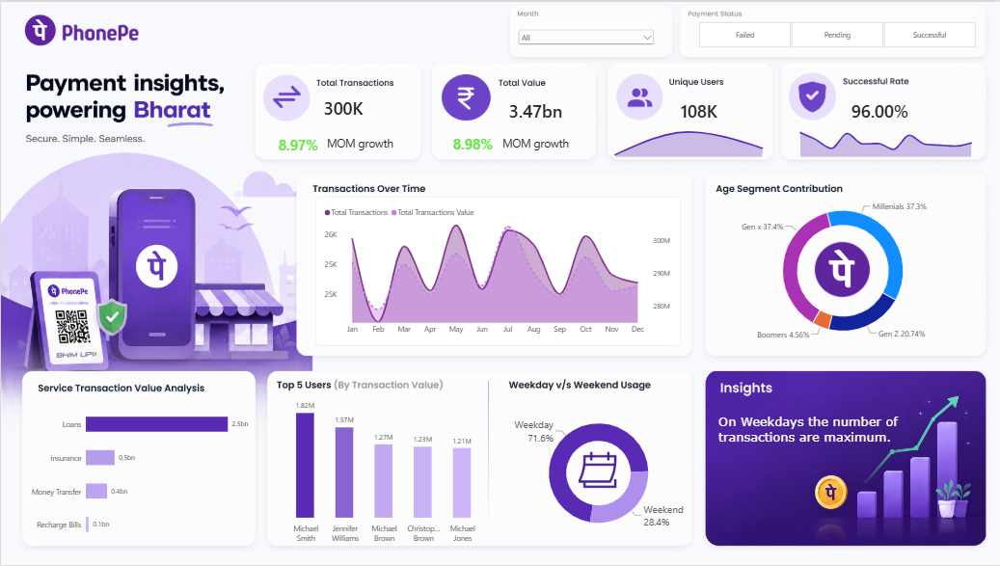

# PhonePe Transaction Analysis Dashboard | Power BI

An interactive **Power BI dashboard** designed to explore PhonePe transaction performance, payment success, user activity, service-wise transaction value, and usage patterns.

## Dashboard Preview




## Project Overview

This project presents transaction data through a clean, purple-themed dashboard inspired by the PhonePe brand. It brings key performance indicators and visual insights together to help users understand transaction trends and customer behavior.

## Key Performance Indicators (KPIs)

The dashboard highlights:

- **Total Transactions**
- **Total Transaction Value**
- **Unique Users**
- **Successful Transaction Rate**
- **Month-over-Month (MoM) Growth**

The figures shown in the dashboard screenshot are illustrative of the report view and may change when the report is filtered or refreshed.

## Dashboard Features

- **Month and Payment Status filters** to explore the report interactively.
- **Transactions Over Time** to compare transaction count and transaction value across months.
- **Age Segment Contribution** to understand activity across user age groups.
- **Service Transaction Value Analysis** for services such as Loans, Insurance, Money Transfer, and Recharge Bills.
- **Top 5 Users** ranked by transaction value.
- **Weekday vs. Weekend Usage** to compare transaction activity by day type.
- **Insights panel** highlighting a key usage observation.

## Tools & Technologies

- Microsoft Power BI
- Power Query (for data preparation, if used in the project)
- DAX (for measures and KPI calculations, if used in the project)

## Repository Contents

Suggested repository structure:

```text
PhonePe-Analysis/
├── Phonepe_Analysis.pbix       # Power BI report file
├── dashboard-preview.png       # Dashboard screenshot
└── README.md                   # Project documentation
```

## How to View the Dashboard

1. Download or clone this repository.
2. Open the `.pbix` file using **Microsoft Power BI Desktop**.
3. Refresh the data if the source files are available and required.
4. Use the Month and Payment Status filters to explore the report.

## Purpose

This project demonstrates dashboard design and analytical storytelling using transaction-related metrics. It can be used as a portfolio project to showcase Power BI reporting and data visualization skills.

## Author

**Avinash Pawar**
Linkedin: ##

If you find this project useful, feel free to star the repository.
